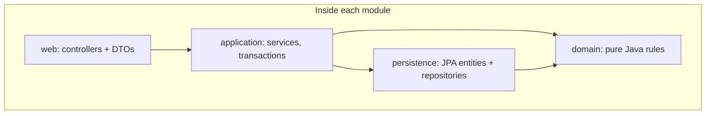
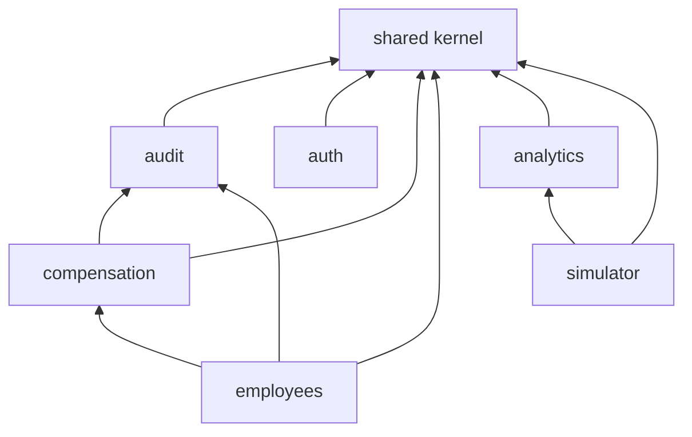
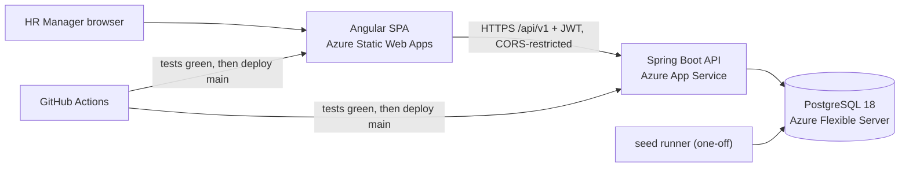
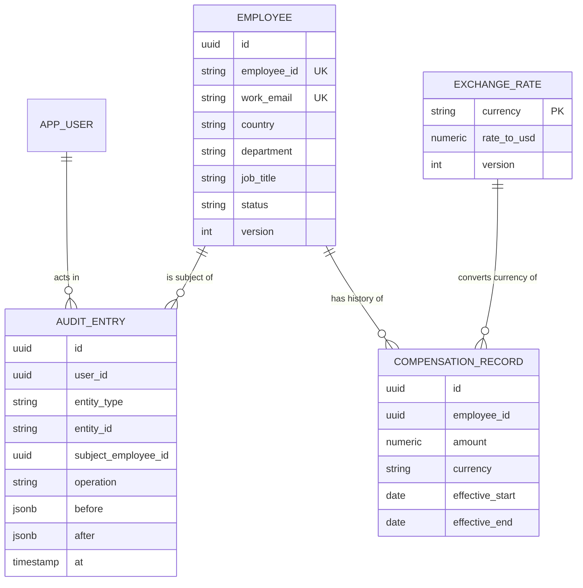

# Architecture Spine — ACME Salary Management

## Design Paradigm

**Modular monolith, package-by-feature, with a framework-free domain core.** One deployable API; six feature modules plus a small shared kernel. Business rules are plain Java that never imports Spring or JPA. Adapters (controllers, persistence) sit at module edges and translate.



Package layout per module: `com.acme.salary.<module>.{api,web,application,domain,persistence}`. `api` is the only package other modules may import.

**Module dependency graph (must stay acyclic, enforced by ArchUnit):**



`analytics` reads data through the read model in AD-6, not through other modules' APIs.

## Invariants & Rules

### AD-1 — Pure domain core `[ADOPTED]`
- **Binds:** FR-5, FR-7, FR-8, FR-10, FR-11
- **Prevents:** rules tangled with Spring/JPA that need a database or mocks to test.
- **Rule:** Median, peer-group, anomaly, simulator, revision and currency-conversion logic live in `domain` packages with no framework imports. ArchUnit fails the build if `domain` imports `org.springframework`, `jakarta.persistence`, Jackson, or anything outside `domain` and `shared`. Domain code gets time from an injected `java.time.Clock`, never `LocalDate.now()`.

### AD-2 — Module boundaries and the dependency graph `[ADOPTED]`
- **Binds:** all
- **Prevents:** modules reaching into each other's tables, entities or cycles.
- **Rule:** Modules are `employees`, `compensation`, `analytics`, `simulator`, `auth`, `audit`, plus `shared`. A module imports another only through its `api` package, following the graph above; ArchUnit checks both this and the absence of cycles. Each table has exactly one writing module (employees: `employee`; compensation: `compensation_record`, `exchange_rate`; audit: `audit_entry`; auth: `app_user`). JPA entities never leave `persistence`; controllers return DTOs. **Use cases spanning modules** are owned by the module higher in the graph and run in one transaction: adding an Employee with an initial salary is orchestrated by `employees`, which calls `compensation.api`. `compensation` stores only `employee_id` (FK) and never loads Employees. `shared` depends on nothing and contains only: `Money`, `Currency`, `Country` (with its currency), `Rounding`, `ExchangeRates` snapshot, Problem Details types, and the correlation-ID filter.

### AD-3 — Money, rates and rounding
- **Binds:** FR-4, FR-5, FR-7, FR-9, FR-10, FR-11, FR-12
- **Prevents:** float errors; two USD figures for one salary; modules defining their own conversion.
- **Rule:** `BigDecimal` only, via the single `shared.Money` type and one conversion function. Salaries are `NUMERIC(19,4)` plus an ISO-4217 code; original amount and currency are the source of truth; USD is computed at read time and never stored. Exchange rates are `NUMERIC(19,8)`, strictly greater than 0, USD fixed at 1 and not editable. Each request loads one **rate snapshot** and uses it throughout. A missing rate fails the request (never skipped). Calculations use unrounded values with `MathContext.DECIMAL128`; `Rounding` applies HALF_UP to 2 decimal places for presentation only. Median of an even-sized group is the exact mean of the two middle values. Sorting or ranking by salary (FR-2, FR-8) uses USD equivalent.

### AD-4 — Salary history is append-and-close, never overwrite
- **Binds:** FR-3, FR-5, FR-6, FR-12
- **Prevents:** lost history; two "current" salaries; concurrent edits leaving overlapping records.
- **Rule:** The only way to change a salary is the domain operation `revise(latestRecord, newAmount, effectiveStart)`. It requires `effectiveStart` strictly after the latest record's start, closes that record with `effective_end = effectiveStart − 1 day`, and inserts the new record with `effective_end = NULL` (the open record is the one with a null end; no sentinel dates). No code path updates `amount` on an existing record. **Current** = the record whose range covers today, where today is the date of the injected `Clock` in UTC. Database constraints: unique `(employee_id, effective_start)`, `effective_end >= effective_start`, and a PostgreSQL exclusion constraint (`btree_gist`) forbidding overlapping ranges per employee, so concurrent revisions fail with a 409 instead of corrupting history. The revision currency is always the latest record's currency.

### AD-5 — Audit is explicit, transactional and uniform `[ADOPTED]`
- **Binds:** FR-4, FR-5, FR-6, FR-9
- **Prevents:** a change without an audit entry or the reverse; AOP hiding behaviour; incompatible audit payloads.
- **Rule:** The `audit` module's `api` exposes `AuditTrail.record(AuditEvent)`, annotated `@Transactional(propagation = MANDATORY)` so it fails if called outside the caller's transaction (no `REQUIRES_NEW`). Application services of `employees` and `compensation` call it explicitly in the same transaction as the write; if either fails, both roll back. **One business operation writes exactly one entry.** `AuditEvent` = `userId`, `entityType` ∈ {EMPLOYEE, COMPENSATION_RECORD, EXCHANGE_RATE}, `entityId`, `subjectEmployeeId` (null for exchange rates), `operation` ∈ {CREATE, UPDATE, REVISE}, `before`/`after` (JSON objects of changed, allowlisted fields only; money as `{amount, currency}` decimal strings), `timestamp` from the `Clock`. Each entity defines its own allowlist of auditable fields; nothing else is logged. A salary revision is audited as COMPENSATION_RECORD/REVISE under the Employee's `subjectEmployeeId`, so the per-Employee trail (FR-6) contains it. Entries are append-only (no update/delete in code or API). ArchUnit requires that every application service that writes through a repository also depends on `AuditTrail`. Integration tests prove a failing audit write rolls back the business change.

### AD-6 — Analytics from one read model, computed in the domain `[ADOPTED]`
- **Binds:** FR-7, FR-8, FR-10, FR-11
- **Prevents:** analytics, anomalies and the simulator disagreeing; rule logic split between SQL and Java; modules fighting over a cross-module join.
- **Rule:** The `analytics` module owns a read-only database view `v_current_salary` (created by migration) joining active Employees with their Current Compensation Record, and the single projection query over it (country, department, job title, employee ids, amount, currency). This view is the only sanctioned cross-module table read; `simulator` consumes `analytics.api`. "Active" means employment status ACTIVE (not ON_LEAVE or TERMINATED). All statistics, medians, peer-group flags and simulations are computed in the domain layer from that projection and one rate snapshot. Peer group key = country + department + job title (normalized, case-insensitive). Anomaly rule: flag when strictly more than 20% above or below the group median of USD-equivalent salaries, only for groups of at least 5. SQL aggregation or caching only after profiling shows a need.

### AD-7 — Exchange Rates
- **Binds:** FR-9, FR-7, FR-11
- **Prevents:** inconsistent rates between reports; unaudited rate edits.
- **Rule:** Owned by `compensation`. One current rate per currency; edits by any authenticated user; each edit is audited (EXCHANGE_RATE/UPDATE) and uses optimistic locking (`@Version`). The initial rates are Flyway reference data (AD-12).

### AD-8 — Authentication `[ADOPTED]`
- **Binds:** FR-1, all endpoints
- **Prevents:** unauthenticated access; inconsistent identity in audit; inconsistent 401s.
- **Rule:** Spring Security, BCrypt, stateless JWT valid about 1 hour, no refresh flow. Every endpoint requires a valid token except `POST /api/v1/auth/login`. One access level. The user ID comes from the token principal only and is passed into application services; never from request bodies. 401/403 are produced through the same Problem Details format as every other error (custom entry point and access-denied handler). Failed logins return one generic message.

### AD-9 — API contract `[ADOPTED]`
- **Binds:** all endpoints, FR-2 to FR-11 (UI)
- **Prevents:** per-module differences in shapes, paging, errors, ids and routes.
- **Rule:** REST/JSON under `/api/v1`; ISO-8601 dates; UUID primary keys. Employee ID (`EMP-000001`) is server-generated and unique. **Shapes:** money is `{"amount": "85000.00", "currency": "EUR"}` (decimal string); percentages are plain numbers meaning percent (`10` = 10%); pages are `{items, page, size, totalElements, totalPages}` with a hard maximum `size`; sort fields are whitelisted per endpoint. **Errors:** RFC 7807 Problem Details from one shared handler, with an extension `code` (for example `DUPLICATE_EMPLOYEE_EMAIL`, `REVISION_OVERLAP`, `VALIDATION_FAILED`) and per-field `errors` for validation. **Route ownership:** `employees` owns `/employees` (list, search, get, create, update) and `/employees/{id}/audit`; `compensation` owns `/employees/{id}/salary-history`, `/employees/{id}/salary-revisions` and `/exchange-rates`; `analytics` owns `/analytics/**` and `/anomalies`; `simulator` owns `/simulations`; `audit` owns `/audit`; `auth` owns `/auth/**`. Concurrent edits to Employees and Exchange Rates use `@Version` and return 409 on conflict.

### AD-10 — Frontend is presentation only `[ADOPTED]`
- **Binds:** FR-1 to FR-11 (UI)
- **Prevents:** business rules duplicated in the browser; token leakage.
- **Rule:** Angular standalone components, lazy-loaded feature routes, Angular Material. All calculations come from the API. The JWT lives in memory only (never `localStorage`/`sessionStorage`). An HTTP interceptor attaches it and redirects to sign-in on 401 except for the login call itself; a route guard protects pages. Server state flows through RxJS services; search inputs are debounced. The API base URL is read at startup from a deployed `config.json`, not baked into the build.

### AD-11 — Reference data, seed and environments
- **Binds:** FR-12, operations
- **Prevents:** schema drift; secrets in the repo; a seed that bypasses invariants silently; an irreproducible demo.
- **Rule:** Flyway migrations are the only schema change path and run at API startup (`spring.jpa.hibernate.ddl-auto=validate`). Reference data (supported currencies and initial exchange rates) is a Flyway migration. HR accounts and the 10,000 Employees come from a separate **seed runner**: a Spring profile `seed` run as a one-off command (locally, and in Azure via a manual workflow), idempotent (does nothing if employees exist), using a fixed random seed, a fixed base date and generated UUIDs derived from the seed so output is reproducible, with batched inserts. The seed writes through repositories but is the single sanctioned bypass of AD-4 and AD-5: it creates baseline history and no audit entries, and SM-2 applies to application-made revisions. Environments: `local`, `test` (CI), `prod`, selected by Spring profile. Config and secrets come from environment variables (Azure App Settings, GitHub secrets); `.env.example` is committed; the app refuses to start in `prod` without a JWT signing key of at least 256 bits. CORS allows only the configured frontend origin.

### AD-12 — Delivery and operations
- **Binds:** operations, NFRs
- **Prevents:** deploys of untested code; ungoverned environments.
- **Rule:** GitHub Actions on every push: backend build, domain unit tests, Testcontainers integration tests, frontend tests and production build. Deploy of `main` runs only after all of those pass, and a Playwright smoke test (login, employee search, simulation) runs in CI against the built app before deploy. Hosting: Azure Static Web Apps (SPA, calling the API directly with CORS), Azure App Service (API), Azure Database for PostgreSQL Flexible Server; Render/Netlify are fallbacks. App Service health check uses `/actuator/health`; `/actuator/info` is exposed; logs are structured JSON with a correlation ID on every request and log line. Azure resources are created by hand following the README for v1 (infrastructure as code is deferred). The 500 ms NFR is measured on the deployed tier, so the tier is recorded in the README.

### AD-13 — Test-first, fast by default `[ADOPTED]`
- **Binds:** all
- **Prevents:** a slow, flaky suite; untested rules.
- **Rule:** Domain unit tests need no database or Spring context and are the bulk of the suite. Persistence integration tests use Testcontainers PostgreSQL, the authoritative database environment, and cover Flyway migrations, revision transactions and the overlap constraint, audit rollback and repository queries. The schema uses PostgreSQL-specific features (exclusion constraint, jsonb, views), so there is no H2 fallback: local development uses Docker (Testcontainers or `docker compose` Postgres). Tests are written before implementation and committed in small steps.

## Consistency Conventions

| Concern | Convention |
| --- | --- |
| Naming | `com.acme.salary.<module>.{api,web,application,domain,persistence}`; DTOs end in `Request`/`Response`; Angular files by feature folder |
| Data & formats | UUID ids; ISO dates; ISO-4217 currency; money object with decimal-string amount; Problem Details with `code` |
| Reference values | Country is a shared enum (with its currency); employment status ∈ {ACTIVE, ON_LEAVE, TERMINATED}; department and job title are free text, trimmed with whitespace collapsed, grouped case-insensitively |
| State & cross-cutting | One shared exception handler; correlation ID header on every request and log line; structured JSON logs; user ID from the principal only; time only via `Clock` |
| Validation | Bean Validation at the web edge; domain invariants in domain classes; database constraints as the last line |
| Country changes | Editing an Employee's country does not change their salary currency; peer groups compare USD equivalents so mixed currencies stay correct |

## Stack

| Name | Version |
| --- | --- |
| Java | 21 LTS (Boot 4 supports 17+) |
| Spring Boot | 4.1.x (latest stable at last check; stay on 4.1 for the build) with `spring-boot-starter-flyway` (Boot 4 needs it for Flyway) |
| Gradle | wrapper, current stable that Boot 4.1 supports |
| PostgreSQL | 18, pinned everywhere (Testcontainers image, Azure server, local compose) |
| Flyway, Testcontainers | managed by the Spring Boot BOM; Testcontainers 2.x module names (`testcontainers-postgresql`) |
| JUnit, AssertJ, Mockito | managed by the Spring Boot BOM (JUnit major version as managed; confirm at scaffold) |
| ArchUnit | not BOM-managed; pin explicitly at scaffold (latest 1.4.x) |
| Angular | 22 |
| TypeScript, RxJS | 6.0, 7.4+ (Angular 22 requirements) |
| Node | 24 LTS |
| Angular Material | matches Angular 22 |
| Playwright | pin latest stable at scaffold |

## Structural Seed





`v_current_salary` (read-only view, owned by `analytics`) joins active `EMPLOYEE` with the `COMPENSATION_RECORD` whose range covers today.

```text
repo/
  backend/   # Gradle; com.acme.salary.{employees,compensation,analytics,simulator,auth,audit,shared}; db/migration; seed profile
  frontend/  # Angular; features/{dashboard,employees,compensation,anomalies,simulator,audit,exchange-rates,auth}
  e2e/       # Playwright smoke: login, employee search, simulation
  docs/      # README support, design notes
  .github/workflows/
```

## Capability → Architecture Map

| Capability | Lives in | Governed by |
| --- | --- | --- |
| FR-1 sign in/out | auth | AD-8 |
| FR-2, FR-4 employees (search, add, edit) | employees | AD-2, AD-5, AD-9 |
| FR-3 view employee + salary history | employees (profile), compensation (history) | AD-2, AD-4, AD-9 |
| FR-5 revise salary | compensation | AD-3, AD-4, AD-5 |
| FR-6 audit entries and trails | audit | AD-5, AD-9 |
| FR-7, FR-8 analytics | analytics | AD-1, AD-3, AD-6 |
| FR-9 exchange rates | compensation | AD-3, AD-5, AD-7 |
| FR-10 anomalies | analytics | AD-1, AD-3, AD-6 |
| FR-11 simulator | simulator | AD-1, AD-6 |
| FR-12 seed | seed runner | AD-4, AD-11 |
| NFR performance, operability | all, delivery | AD-6, AD-12 |

## Deferred

- Caching and SQL aggregation: wait for profiling evidence (AD-6).
- Refresh tokens and token revocation: revisit when sessions must outlive an hour.
- Infrastructure as code (Bicep/Terraform): README steps for v1.
- OpenAPI-generated Angular client: hand-written typed DTOs matching AD-9 shapes for v1.
- Role-based permissions, public sign-up, bulk Excel import, exchange-rate history: PRD non-goals.
- External monitoring and alerting: Actuator health/info and structured logs only.
- Backups, scaling and high availability: Azure managed defaults.
- Employee relocation (changing country together with a new currency and salary): v1 only edits the country field.
