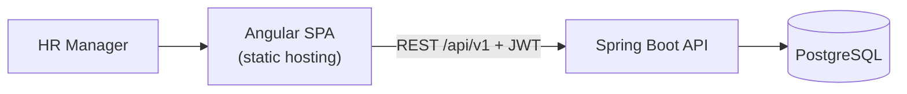
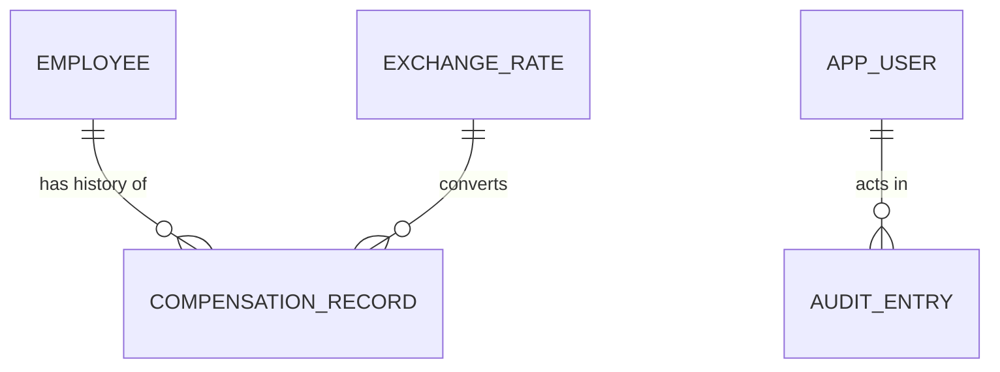
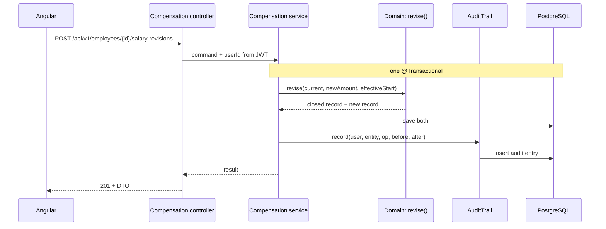

# Design Notes — ACME Salary Management

A short, human-readable companion to `ARCHITECTURE-SPINE.md` (the terse build contract). This note explains *why*, with the tradeoffs. Requirements are in the PRD; decision IDs (AD-n) refer to the spine.

## What we are building

A web app for ACME's HR Managers to manage salaries for 10,000 employees across eight countries, compare pay in USD, spot potential pay anomalies, simulate raises, and see who changed what. Priorities: analytics, then currency/data consistency, then anomalies, then record management. A working end-to-end product beats extra infrastructure.

## System shape

Two deployables, one database. The API is a **modular monolith**: six feature modules (employees, compensation, analytics, simulator, auth, audit), each split into `web`, `application`, `domain` and `persistence`. The business rules in `domain` are plain Java.

## Key decisions and tradeoffs

| Decision | Chosen | Alternatives weighed | Why / cost |
| --- | --- | --- | --- |
| Paradigm | Modular monolith, pure domain core | Plain layered MVC; full hexagonal/DDD | Rules (median, anomaly, simulator, revision) test in milliseconds with no database or mocks. MVC would tangle rules with JPA; full DDD is more ceremony than 12 requirements earn. Cost: a little mapping code between entities and domain objects. |
| Deployment | Separate SPA and API | Single jar serving the SPA | Closer to real production and shows frontend/backend separation. Cost: explicit CORS and environment config. |
| Auth | Stateless JWT, ~1h, in memory | Server session cookie | No cross-site cookie or CSRF complexity across two origins. Cost: reload means sign in again; no easy revocation. Chosen for v1 simplicity. |
| Audit | Explicit transactional calls | AOP aspect | Auditability is a core requirement, so the behaviour should be visible in the application flow and easy to test. Cost: each service must remember the call; mitigated by rollback tests. |
| Analytics | Computed in domain over a lightweight projection | SQL aggregation (`percentile_cont`) | Keeps rules independently testable; 10k rows is trivial in memory. Cost: pulls all current salaries per request; optimise with caching/SQL only if profiling shows a need. |
| Money | `BigDecimal`, `NUMERIC(19,4)`, USD computed at read time | Store USD alongside | One source of truth; editing a rate restates every report. Cost: conversion on every read (cheap). |
| Salary history | Append-and-close revisions | Overwrite the amount | Preserves history and makes audit meaningful. Cost: slightly more complex writes and queries (current = range covers today). |
| Anomaly rule | >20% from peer-group median of USD equivalents, group of 5+ | z-score; original-currency comparison | Explainable to HR. USD is used because an employee's country can change while their salary currency stays, so a peer group can briefly mix currencies. |
| DB testing | Testcontainers PostgreSQL, no H2 | H2 fallback | Same engine as production; the schema uses an exclusion constraint, jsonb and a view that H2 cannot run, so an H2 fallback would hide real failures. Cost: needs Docker locally. |

## Module boundaries

Modules depend on each other only through `api` packages, in one direction (employees → compensation → audit; simulator → analytics). The analytics read model is a read-only view over current salaries, so analytics, anomalies and the simulator always agree. ArchUnit enforces the graph, forbids cycles and keeps `domain` free of Spring/JPA.

## Core data model

Employee profile and salary are separate tables so a salary change never rewrites the profile. Compensation records carry effective start/end dates; the one covering today is current. A database exclusion constraint forbids overlapping ranges, so two simultaneous revisions cannot leave two current salaries.

## The salary revision flow (the heart of the system)

If the audit insert fails, the whole transaction rolls back and the salary does not change. An integration test proves this against a real PostgreSQL.

## Testing strategy

- **Domain unit tests** (the bulk): no Spring, no database, run in milliseconds. Cover revision, median/anomaly, USD conversion, rounding and the simulator.
- **Architecture test** (ArchUnit): fails the build if `domain` imports Spring or JPA, or one module reaches another's internals.
- **Persistence integration tests** (Testcontainers PostgreSQL): Flyway migrations, revision transactions, audit rollback, repository queries.
- **Frontend**: component and service tests, plus a Playwright smoke test for login, employee search and a salary simulation.
- Test-first: failing tests are committed before the implementation, so the history shows the approach.

## Performance considerations

- 10,000 rows: lists are paginated and filtered on the server; analytics read one narrow projection and compute in memory.
- Seeding: deterministic, idempotent and batched, targeting under a minute; run as a one-off command, including against Azure.
- Indexes on employee search/filter columns and on `(employee_id, effective_start)`.
- Revisit: caching and SQL aggregation if profiling shows a bottleneck.

## Delivery and operations

GitHub Actions builds and tests the backend (including Testcontainers) and frontend on every push, then deploys `main` to Azure: Static Web Apps (SPA), App Service (API), PostgreSQL Flexible Server. Render/Netlify are the fallback. Configuration is through environment variables and Spring profiles; `.env.example` is committed, secrets are not. Observability stays practical: Actuator health/info, structured JSON logs and a correlation ID per request.

## First milestone

A working end-to-end app before any deployment polish: log in, browse 10,000 seeded employees, edit compensation, view analytics, detect anomalies, simulate increments, and inspect audit history. Then deploy.

## Deliberately not doing

Payroll, tax, bonuses, benefits, roles/permissions, live exchange rates, refresh tokens, Excel import and external monitoring. See the PRD for reasons.
